# Case 01 — NetSupport RAT Network Traffic Investigation

**Category:** Network Forensics / SOC Investigation  
**Tool:** Wireshark  
**Evidence Source:** PCAP traffic analysis exercise  
**Traffic Date:** February 28, 2026  
**Analyst:** Tim Popov

## 1. Executive Summary

This investigation examines suspicious network traffic involving a Windows workstation communicating with an external IP address over TCP port 443.

The analysis identified repeated HTTP POST requests containing NetSupport Manager protocol indicators, a persistent TCP connection, and approximately one-minute communication intervals consistent with command-and-control (C2) beaconing behavior.

The affected workstation was identified as `10.2.28.88`, with hostname `DESKTOP-TEYQ2NR` and MAC address `00:19:d1:b2:4d:ad`. Kerberos and SAMR traffic associated the workstation with the domain account `brolf`, whose full name was recorded as Becka Rolf.

Additional analysis revealed recurring NetBIOS name registration attempts involving the name `EASYAS123`, with responses indicating that the name was already owned by another node. These events occurred during the same general period as the suspicious external communications. Their relationship to the suspected RAT activity remains unconfirmed.

**Assessment:** Network traffic is consistent with NetSupport-based remote-access activity and suspected C2 communication. The PCAP alone does not establish the initial infection vector or the exact commands executed on the workstation.

## 2. Investigation Environment

| Item | Value |
|---|---|
| Analysis tool | Wireshark |
| Evidence file | `2026-02-28-traffic-analysis-exercise.pcap` |
| Internal subnet | `10.2.28.0/24` |
| Suspected affected host | `10.2.28.88` |
| External endpoint | `45.131.214.85` |
| Destination port | TCP 443 |
| Domain | `easyas123.tech` |
| Domain controller | `10.2.28.2` |
| Protocols examined | TCP, HTTP, NBNS, Kerberos, SAMR |

## 3. Investigation Methodology

### 3.1 Initial Discovery

I began by examining HTTP traffic in Wireshark, focusing on GET and POST requests.

During this review, I observed repeated HTTP POST requests from the same internal workstation to an external IP address. The requests used a consistent URL and appeared at regular intervals.

I isolated the relevant traffic using the TCP stream filter:

`tcp.stream eq 40`

The stream showed communications between:

- Internal client: `10.2.28.88:51912`
- External endpoint: `45.131.214.85:443`

To validate the connection, I examined the initial TCP three-way handshake (SYN, SYN-ACK, ACK).

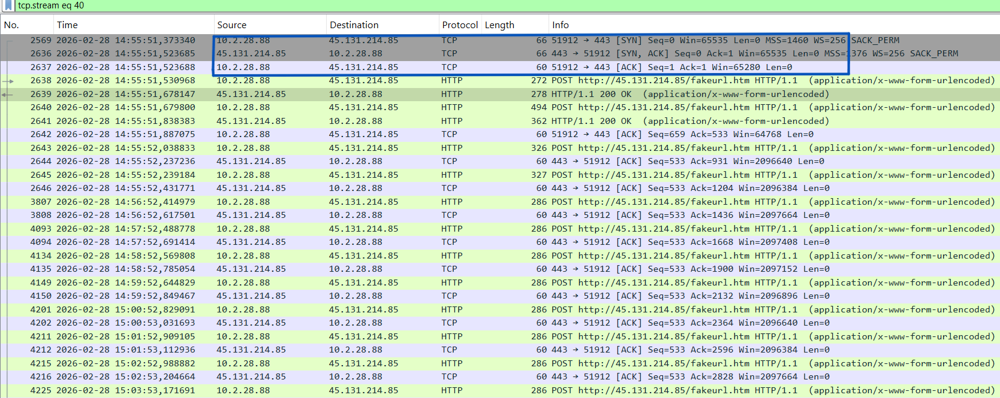

### 3.2 HTTP Protocol Indicators

Inspection of the HTTP request headers revealed the following indicators:

- HTTP method: `POST`
- Request URI: `http://45.131.214.85/fakeurl.htm`
- User-Agent: `NetSupport Manager/1.3`
- Content-Type: `application/x-www-form-urlencoded`
- Connection: `Keep-Alive`

The initial request contained:

```text
CMD=POLL
INFO=1
ACK=1
```

The `POLL` value is consistent with a client checking in with a remote NetSupport service. This observation does not, by itself, prove which commands were executed on the endpoint.

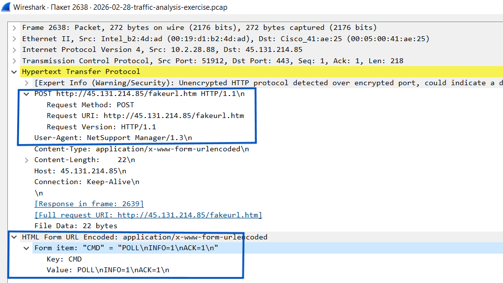

### 3.3 Server Response and Encoded Payloads

Following the initial request, the remote endpoint returned an HTTP 200 OK response with a server header identifying:

`NetSupport Gateway/1.92 (Windows NT)`

The response body included:

```text
CMD=ENCD
ES=1
DATA=<binary payload>
```

Additional client requests also contained `CMD=ENCD` and binary-looking data.

The payload was not successfully decoded during this investigation. Consequently, I did not attribute a specific encryption algorithm, executable command, or data-exfiltration operation to its contents.

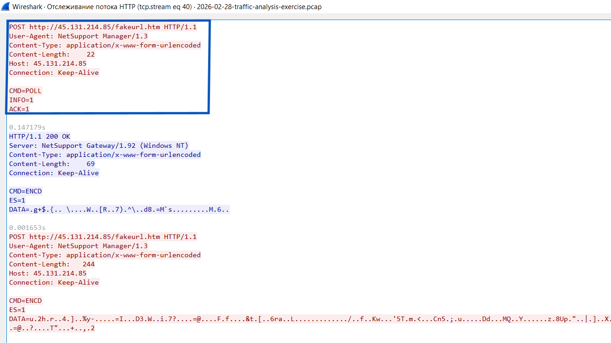

### 3.4 Periodic Communication Analysis

Further examination showed repeated outbound HTTP POST requests approximately every 60 seconds.

The repeated timing, stable destination IP address, consistent URI, and NetSupport protocol indicators support an assessment of periodic C2-style communication.

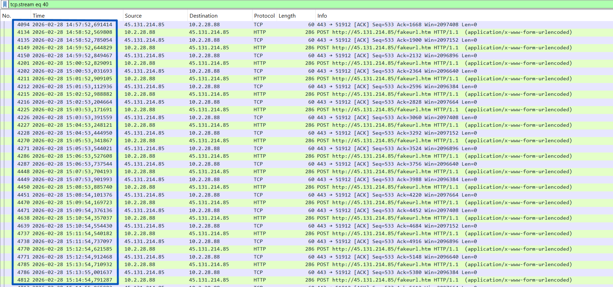

I also reviewed Wireshark's **Statistics → Conversations** view to assess the duration and volume of the external connection.

The conversation between `10.2.28.88` and `45.131.214.85` contained approximately:

| Metric | Observed value |
|---|---|
| Total packets | 550 |
| Total transferred | 96 kB |
| Client-to-server | 276 packets / 79 kB |
| Server-to-client | 274 packets / 17 kB |
| Conversation duration | 15,637 seconds (approximately 4 hours 20 minutes) |

The larger client-to-server byte count does not, by itself, prove data exfiltration.

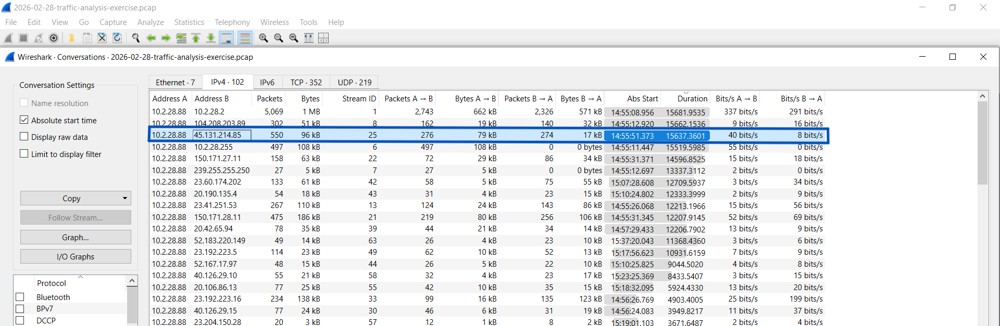

## 4. Affected Host Identification

### 4.1 Hostname Discovery Through NBNS

To identify the workstation associated with the suspicious connection, I examined NetBIOS Name Service (NBNS) traffic.

The internal IP address `10.2.28.88` transmitted name registration requests for:

`DESKTOP-TEYQ2NR`

These broadcasts linked the observed IP address to the workstation hostname.

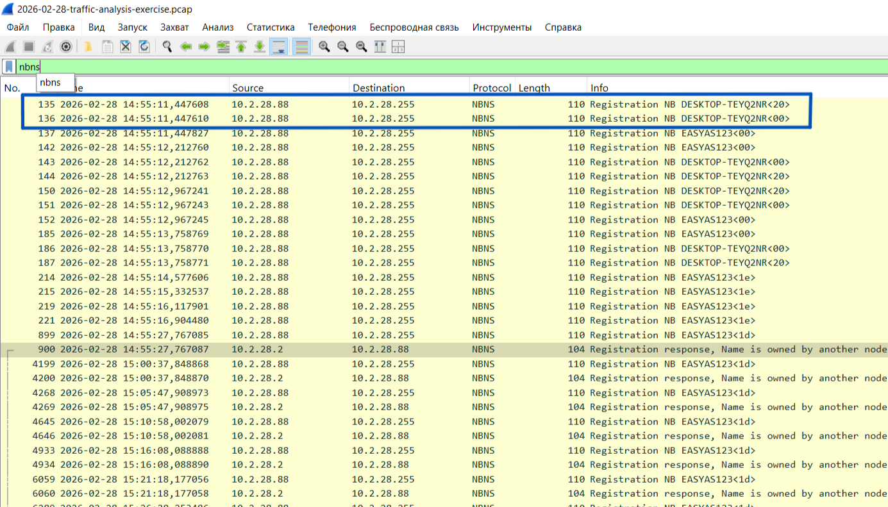

### 4.2 MAC Address Identification

The Ethernet II header of an NBNS registration packet showed:

- Source MAC: `00:19:d1:b2:4d:ad`
- Source IP: `10.2.28.88`

This provides a direct packet-level association between the workstation's observed IP address and its network interface MAC address.

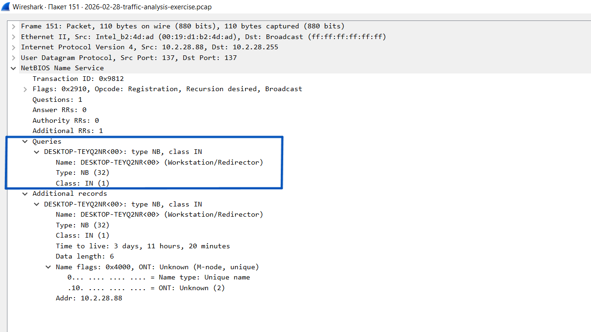

## 5. User Account Attribution

### 5.1 Kerberos Authentication

I examined Kerberos authentication traffic between the affected workstation and the domain controller at `10.2.28.2`.

The packet sequence included an initial AS-REQ, a pre-authentication-required response, and a subsequent AS-REQ/AS-REP exchange.

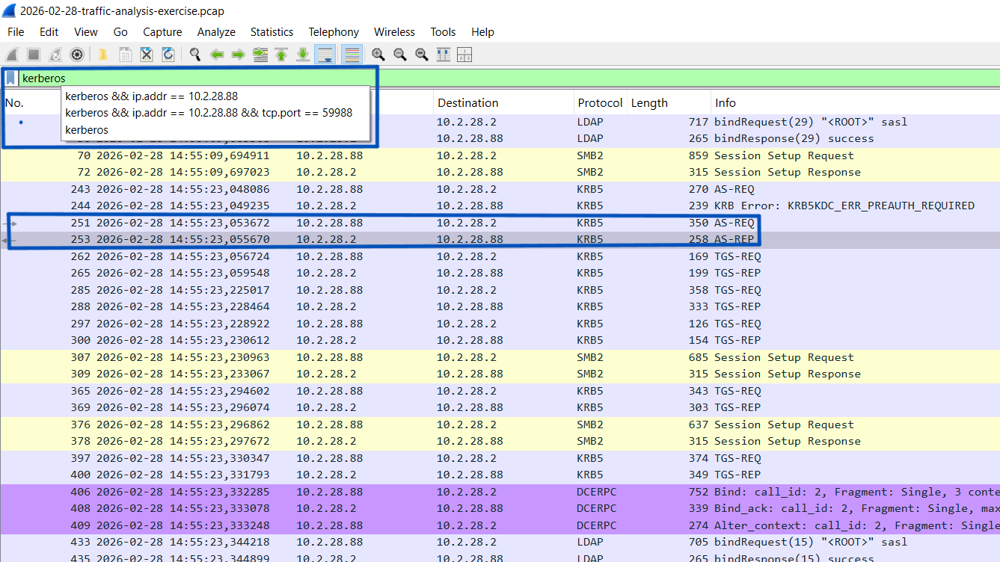

The Kerberos AS-REP identified the client principal as:

`brolf`

This associates the account with authentication activity originating from the affected workstation. It does not establish that the account initiated or executed the suspected RAT.

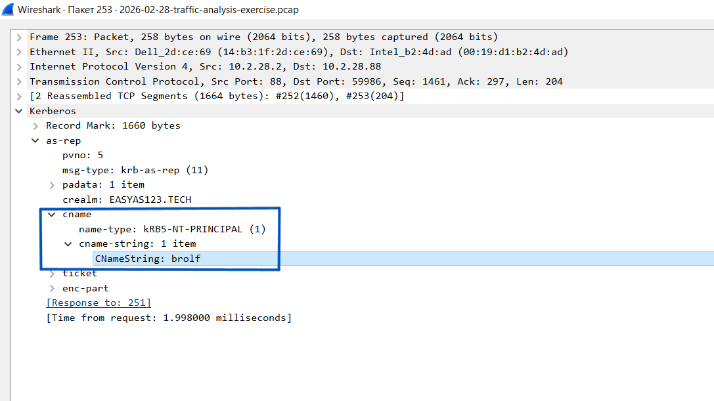

### 5.2 Full Name Identification Through SAMR

To investigate the account identity further, I examined Security Account Manager Remote Protocol (SAMR) traffic.

A `QueryUserInfo` response from the domain controller contained the account information associated with `brolf`.

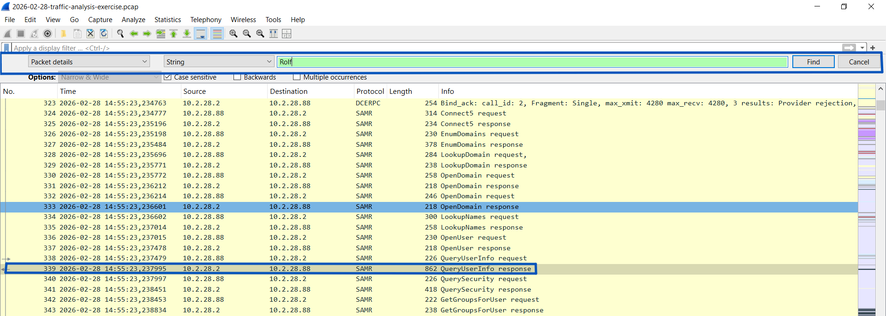

The response exposed the following fields:

```text
Account Name: brolf
Full Name: Becka Rolf
```

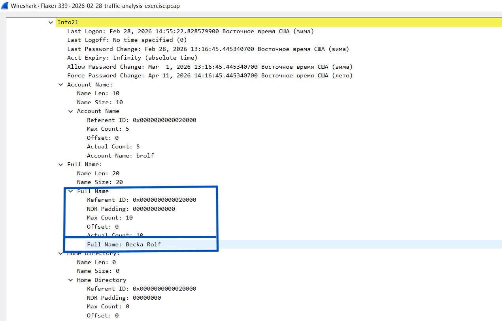

This confirms the directory account's recorded full name, rather than proving who was physically using the workstation at the time.

## 6. Additional Finding — Repeated NBNS Name Registration

During the analysis, I also observed repeated NBNS registration attempts from `10.2.28.88` involving the name `EASYAS123<1d>`.

The domain controller at `10.2.28.2` repeatedly responded that the name was already owned by another node.

The requests occurred at intervals of approximately five minutes and continued during the broader period of suspicious external traffic.

This behavior was recorded as an additional anomaly because of its repetition and temporal overlap with the suspected C2 communications.

However, NetBIOS name suffixes have specific meanings, and a registration attempt for `EASYAS123<1d>` should not automatically be interpreted as an attempt to impersonate the domain controller or take over its computer name.

**Assessment:** The recurring registrations warrant further investigation, but the available PCAP does not establish a causal connection to the NetSupport traffic.

## 7. Indicators of Compromise and Investigation Artifacts

| Indicator | Value | Context |
|---|---|---|
| Suspected C2 endpoint | `45.131.214.85` | External NetSupport communication |
| Destination port | TCP 443 | Cleartext HTTP observed |
| HTTP URI | `/fakeurl.htm` | Repeated POST requests |
| User-Agent | `NetSupport Manager/1.3` | NetSupport protocol indicator |
| Server header | `NetSupport Gateway/1.92 (Windows NT)` | Remote endpoint identification |
| Affected IP | `10.2.28.88` | Internal workstation |
| MAC address | `00:19:d1:b2:4d:ad` | Workstation network interface |
| Hostname | `DESKTOP-TEYQ2NR` | NBNS registration |
| Domain account | `brolf` | Kerberos and SAMR |
| Recorded full name | Becka Rolf | SAMR account information |

The internal host identifiers and account details are investigation artifacts. They should not be treated as universally malicious indicators outside this exercise.

## 8. MITRE ATT&CK Mapping

**T1071.001 — Application Layer Protocol: Web Protocols**

The repeated HTTP POST communications with the external NetSupport endpoint are consistent with the use of web protocols for command-and-control communication.

This mapping describes the observed network behavior. It does not establish which additional ATT&CK techniques may have occurred on the endpoint.

## 9. Limitations

This investigation was conducted using network packet capture evidence.

The available evidence did not establish:

- The initial infection vector.
- The process responsible for launching the NetSupport component.
- The exact contents or meaning of the encoded payloads.
- Whether sensitive data was exfiltrated.
- Whether the recurring NBNS registrations were caused by the suspected RAT.

Endpoint telemetry, process execution logs, memory analysis, and additional network evidence would be required to answer these questions reliably.

## 10. Conclusion

The investigation identified a Windows workstation maintaining prolonged, periodic HTTP communication with an external endpoint presenting NetSupport Manager and NetSupport Gateway protocol indicators.

Packet-level analysis established the affected IP address, MAC address, hostname, associated domain account, and recorded account full name.

The combination of recurring HTTP POST traffic, protocol-specific headers, encoded payloads, and sustained communication supports the assessment of suspected NetSupport-based C2 activity.

The investigation also documented repeated NBNS name registration behavior as a separate observation requiring further validation.

**Final Assessment:** Suspected NetSupport RAT command-and-control traffic, supported by network evidence. Endpoint compromise details and command execution remain outside the visibility of this PCAP.

---

## References

- [Malware Traffic Analysis — February 28, 2026 Exercise](https://www.malware-traffic-analysis.net/2026/02/28/index.html)
- [MITRE ATT&CK — T1071.001: Web Protocols](https://attack.mitre.org/techniques/T1071/001/)
- [Wireshark Documentation](https://www.wireshark.org/docs/)

*This case study is an educational network-forensics investigation based on a publicly available traffic analysis exercise. The analysis and screenshots document my investigation workflow.*
